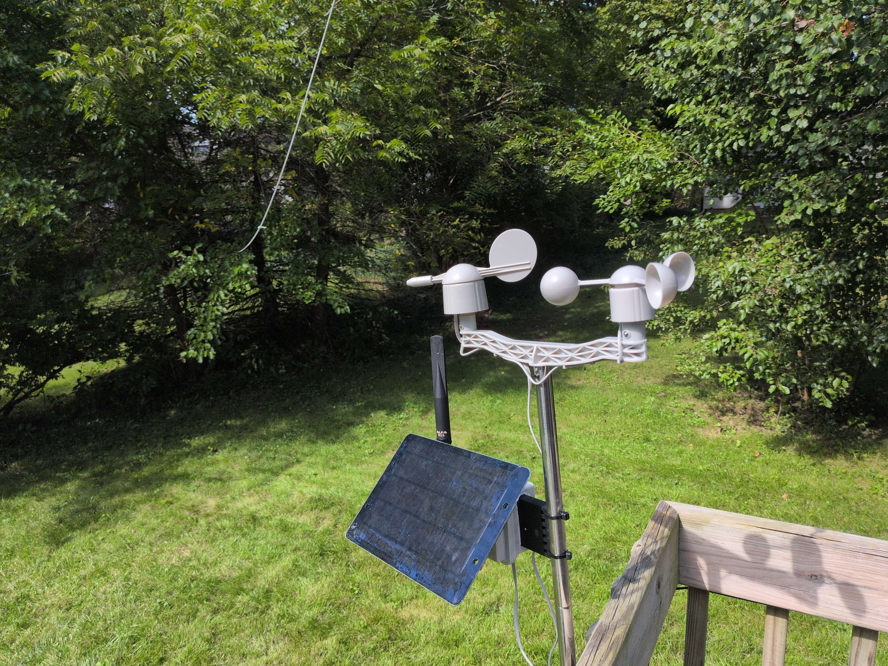
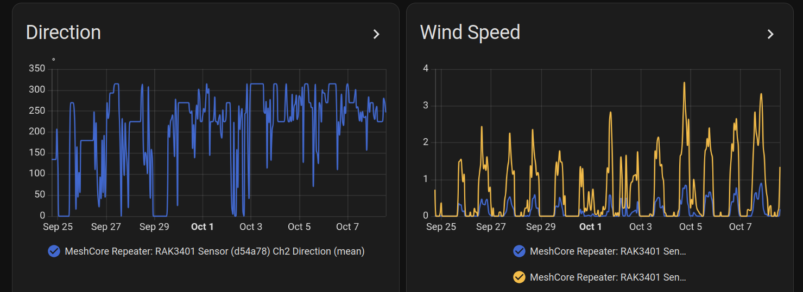

# MeshCore Weather Station



A solar-powered wind and rain station that reports over a LoRa mesh (MeshCore) to Home Assistant. No WiFi or cellular needed.

- The hardware design is intended to be accessible to a typical electronics hobbyist.
- A Qwiic Pro Micro reads the [Argent Data Wind / Rain Sensor Assembly](https://argentdata.com/product/wind-rain-sensor-assembly/) and sends the readings to a RAK MeshCore radio, which broadcasts them to the mesh.
- The software has no external dependencies, and `lib/WeatherCore` should work on any platform with floats.
- The software averaging and analysis are intended to follow standard algorithms:
  - Wind speed: mean over 10 minutes, the WMO sustained-wind window.
  - Wind gust: the highest rolling 3-second mean in the 10-minute window, per WMO.
  - Wind direction: the speed-weighted vector mean of the vane headings over the same window.
  - Direction variability: the Yamartino standard deviation of the headings (EPA-454/R-99-005).
  - Rain: total over the last 60 complete minutes.

Since upstream MeshCore doesn't support wind data, I had to create forks to get it from the radio to Home Assistant:
- [MeshCore firmware](https://github.com/Blake-Latchford/MeshCore/tree/feature/wind-i2c): reads the board over I2C and sends LPP telemetry.
- [meshcore-ha](https://github.com/Blake-Latchford/meshcore-ha/tree/feature/wind-telemetry-lpp-types): shows the wind and rain telemetry as Home Assistant sensors.
- [meshcore_py](https://github.com/Blake-Latchford/meshcore_py/tree/feature/wind-telemetry-lpp-types): names the wind and rain LPP types.
- [pycayennelpp](https://github.com/Blake-Latchford/pycayennelpp/tree/feature/wind-telemetry-lpp-types): decodes the wind and rain LPP types.



This project has been built with the help of AI.

# Hardware

The build requires some simple soldering, and assumes you have a small amount of thin
(16–22 AWG) wire for connections.
The [SparkFun Qwiic Pro Micro USB-C](https://learn.sparkfun.com/tutorials/qwiic-pro-micro-usb-c-atmega32u4-hookup-guide) reads the Argent Data sensors.
Do **not** connect the 5V from a RAK WisBlock to the sensor board.

A 3.3V USB-serial adapter might be useful for debugging.

## Weather Station
- [SparkFun Weather Meter Kit](https://www.sparkfun.com/weather-meter-kit.html) (SEN-15901)
- [SparkFun Qwiic Pro Micro USB-C](https://www.sparkfun.com/sparkfun-qwiic-pro-micro-usb-c-atmega32u4.html) (DEV-15795)
- 1× 10k (vane divider), e.g. [SparkFun 10k 1/4W 20-pack](https://www.sparkfun.com/resistor-10k-ohm-1-4-watt-pth-20-pack-thick-leads.html) (PRT-14491)
- 2× [RJ11 6-pin jacks](https://www.sparkfun.com/rj11-6-pin-connector.html) (PRT-00132)
- 2× [SparkFun RJ11 Breakout](https://www.sparkfun.com/sparkfun-rj11-breakout.html) (BOB-14021)
- [Flexible Qwiic Cable 100mm](https://www.sparkfun.com/flexible-qwiic-cable-100mm.html)

## MeshCore Radio
This project is designed to integrate with the RAKwireless WisBlock system.
This project was tested with a custom repeater build, however the WisMesh Repeater Mini has most of what you need.
The RAK19007 baseboard may be required to mount the radio to the enclosure cleanly, since the Qwiic connector would need to be on the bottom of the RAK19003 mini base board.

- [RAKwireless WisMesh Repeater Mini](https://store.rokland.com/collections/solar-solutions-for-meshtastic-lora/products/wismesh-repeater-mini-reliable-coverage-expansion-for-smart-networks)
- [RAK13009 Qwiic Module](https://store.rokland.com/products/rakwireless-qwiic-module-rak13009-pid-110075)
- [RAK19007 WisBlock Base Board, 2nd Gen](https://store.rokland.com/products/rak-wireless-wisblock-base-board-2nd-gen-rak19007-ver-b-pid-110082)

# Build Steps
Pin assignments are in [src/Board.h](src/Board.h). The I2C addresses can be overridden in [platformio.ini](platformio.ini).

1. **Set the Pro Micro to 3.3V**
   - Cut the trace on the bottom between VCC and 5V, then bridge VCC to 3.3V
     ([jumper photo](https://cdn.sparkfun.com/assets/learn_tutorials/1/1/1/4/Qwiic_Pro_Micro_C-Jumpers.jpg)).
   - Optional: removing the power LED has considerable power savings
     ([LED photo](https://cdn.sparkfun.com/assets/learn_tutorials/1/1/1/4/Qwiic_Pro_Micro_C-LEDs.png)).

2. **Find the sensor pairs**
   - Consult the [datasheet](https://argentdata.com/files/80422_datasheet.pdf) to decode the RJ11 pin meanings.
   - The datasheet has very useful pin diagrams.
   - I recommend confirming these with a multimeter.

3. **Wire the Wind Vane**
   - Solder the 10k resistor between D4 and A0.
   - Solder wires from the Station RJ11 breakout pins to the corresponding Pro Micro pins:
     - RJ11 pin 2 to Pro Micro A0
     - RJ11 pin 5 to Pro Micro GND

4. **Wire the Anemometer**
   - Solder a wire from Station RJ11 pin 3 to Pro Micro D8.
   - Bridge Station RJ11 pin 4 to pin 5 with a solder blob or short jumper.

5. **Wire the Rain Gauge**
   - Connect Rain Gauge RJ11 pin 3 to Pro Micro D9.
   - Connect Rain Gauge RJ11 pin 4 to Pro Micro GND.

6. **Continuity checks (with RJ11 jacks connected)**
   - Probe Pro Micro D8 and ground. Spin the anemometer and confirm that continuity toggles.
   - Probe Pro Micro D9 and ground. Tilt the rain sensor back and forth and confirm continuity toggles.
   - Measure the resistance between A0 and ground. It should change as the wind vane spins.
   - Probe VCC to [D4, D8, D9, A0]. None should show continuity.

7. **Flash the build.** Double-tap reset on the Pro Micro, then `pio run -e promicro -t upload`.

8. **Connect the radio.** Attach the RAK13009 Qwiic Module to your RAK base board, and run the Qwiic cable to the Pro Micro.

# Source Code

`src/` is specific to the Pro Micro.
`lib/WeatherCore` has no hardware dependencies and builds on any target. A port to another board feeds
it one `WeatherSample` a second; see [lib/WeatherCore/WeatherStation.h](lib/WeatherCore/WeatherStation.h).

## Build & Flash

This project uses [PlatformIO](https://platformio.org/).

```sh
pio run -e promicro -t upload   # build and flash (double-tap reset first, see Build Steps)
```

`promicro_debug` prints each second's readings on the debug serial port (the TX/RX pins) at 250000 baud
(`pio device monitor -e promicro_debug`, through a 3.3V USB-serial adapter).

## I2C register map

- The register map is defined in [lib/WeatherCore/WeatherRegisters.h](lib/WeatherCore/WeatherRegisters.h).
- A single read of the whole map provides a consistent snapshot.
- The register pointer starts at `0x00` and returns there after every read.
- To start part way through the map, write the register offset, then read.
- The board [defaults](src/IICServer.cpp) to address 0x6C; bridge D5–D6 for 0x6E
- This firmware only supports a 100kHz I2C bus, which is the maximum the 2MHz clock can support.
